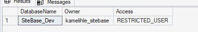
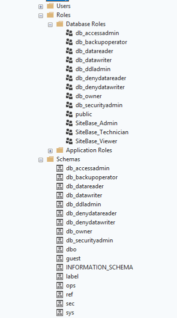
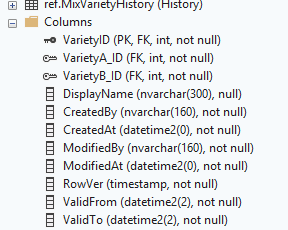

# Stage 1: Master database

**Goal:** create the SiteBase database on SQL Server 2019 Express, with every table stamped (who and when), full change history, roles, data checks, and a cleaned test copy of one marketer's label data.

**Date started:** 6 Nov 2026
**Environment:** SQL Server 2019 Express (RTM 15.0.2000.5), SQL Server Management Studio, development database `SiteBase_Dev` (separate from all existing databases)

---

## 1. Starting point

The existing label data is an Access database built from pasted Excel sheets: one table per retailer label, the same farm and variety details repeated in up to 22 tables, and an earlier attempt (`CA_DBase_SQL`) that copied those tables into SQL Server unchanged.

The new database sits alongside the existing ones (`CA_DBase_SQL`, `DummyDB`, `TechDB`), which were not touched.

## 2. Create the database (`001_create_database.sql`)

Creates `SiteBase_Dev` only, with read-committed snapshot (readers never block writers) and simple recovery for development.

Result: *"SiteBase_Dev is ready."*

## 3. Lock it to the owner (`database/setup/private_dev_access_TEMPLATE.sql`)

A dedicated login owns the database, which is set to `RESTRICTED_USER`: only the owner and server administrators can open it. Nothing else on the server changed.




## 4. Schemas, roles and functions (`002`)

Schemas `ref`, `label`, `ops`, `sec`; roles `SiteBase_Admin`, `SiteBase_Technician`, `SiteBase_Viewer`; `sec.fn_CurrentUser()` (who is saving) and `ref.fn_Gs1CheckDigitOK()` (GTIN/GLN/GGN check digits).



## 5. Tables, stamps and history (`003`-`006`)

28 tables generated from one specification (`database/tools/generate_migrations.py`), so every table gets the same stamps (`CreatedBy/At`, `ModifiedBy/At`), a `RowVer` for conflict detection, and system-versioned history.


Every table shows **(System-Versioned)**, and each has its stamp columns:



## 6. Checks, views, permissions, lookups (`007`-`009`)

`ops.vw_DataProblems` lists everything that would block a publish. `ref.vw_OrchardDetail` gives one row per orchard with everything a label needs.


## 7. Test data (`local/seed_capespan_test.sql`, not in Git)

Cleaned test copy of one marketer's NAM label data: one spelling per farm, one name per variety code, missing leading zeros on GTINs restored.


| Item | Rows |
|---|---:|
| Farms | 9 |
| Varieties | 167 |
| Orchards | 303 |
| Packs | 40 |
| GTINs | 6,354 |
| GTIN–market links | 4,560 |

The pre-publish checks immediately found real problems in the source data:

| Check | Severity | Count | Meaning |
|---|---|---:|---|
| `GTIN_CHECK_DIGIT` | Error | 1 | One GTIN in the source export has an invalid GS1 check digit (its barcode may not scan) |
| `GTIN_UNKNOWN_VARIETY` | Warning | 140 | GTINs use variety codes not yet in the variety list; to be filled from the Paltrack masterfiles |
| `VARIETY_NO_GROUP` | Warning | 48 | Varieties not yet assigned to a white/red/black group |

## 8. Proof: stamps and history work

Run in a new query window:

```sql
USE SiteBase_Dev;
UPDATE ref.Region SET Name = N'Western Cape (test edit)' WHERE RegionCode = 'WC';
UPDATE ref.Region SET Name = N'Western Cape' WHERE RegionCode = 'WC';

SELECT RegionCode, Name, ModifiedBy, ModifiedAt, ValidFrom, ValidTo
  FROM ref.Region FOR SYSTEM_TIME ALL
 WHERE RegionCode = 'WC'
 ORDER BY ValidFrom;
```


Every version of the row is kept with who changed it (`ModifiedBy`) and when it was valid (`ValidFrom` → `ValidTo`). The test was run as `sa`, which is exactly why each person gets their own login: shared accounts make the stamps meaningless.

## 9. Result

**Stage 1 completed 6 Nov 2026.**

- [x] All scripts 001-009 ran without errors
- [x] Seed loaded: 9 farms, 167 varieties, 303 orchards, 40 packs, 6,354 GTINs, 4,560 GTIN–market links
- [x] Data problems found: 1 error, 188 warnings (fixed in the data clean-up step)
- [x] History and stamps work

## 10. Problems hit and how they were solved

_Write down anything that went wrong and the fix. These notes are the most valuable part of a build log._

| Problem | Cause | Fix |
|---|---|---|
| *"Schema sec/ref does not exist"* | `003` was run before `002` had completed | Re-ran `002`, then `003`-`006` in order. Lesson: run migrations strictly in order and check each one's **Messages** tab before the next |
| Hundreds of "invalid object" errors in the Error List | SSMS IntelliSense uses a stale cache of the database; these were not execution errors | **Ctrl+Shift+R** refreshes IntelliSense. Judge scripts by the **Messages** tab, not the Error List |
| `ops.vw_DataProblems` not found | `007` had been skipped | Ran `007`-`009` |
| 010 template run by accident: *"Windows NT user DOMAIN\username not found"* plus a placeholder user row | Template run without being filled in | Deleted the row; the template now refuses to run until its values are filled in, and the guide says to skip it during the build |
| History test showed 2 versions instead of 3 | Period columns were `DATETIME2(2)` (1/100 s). Two updates inside the same tick give a zero-length version, which `FOR SYSTEM_TIME ALL` hides | Generator changed to `DATETIME2(7)` for future builds. Rows are still stored, so there is no data loss |
| `ModifiedBy` shows `sa` | Test run with the shared administrator login | Use the personal login (`kamelihle_sitebase`) from now on; each technician gets their own |
